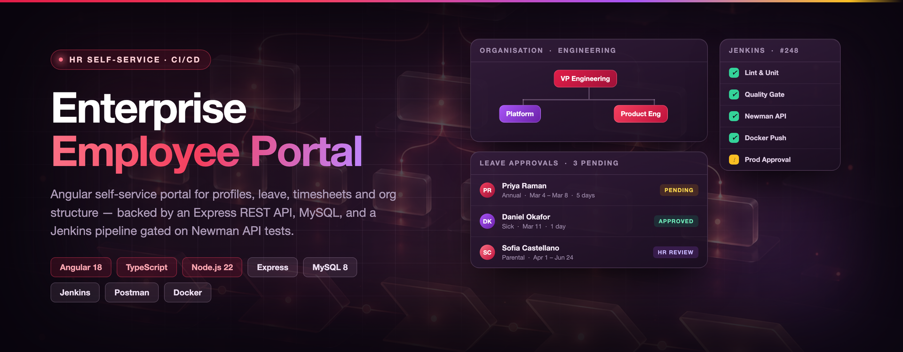
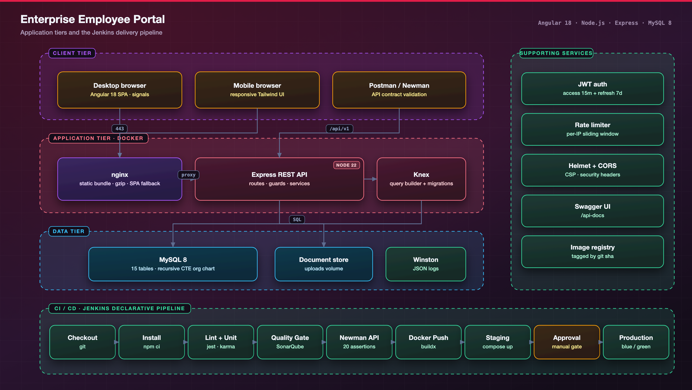
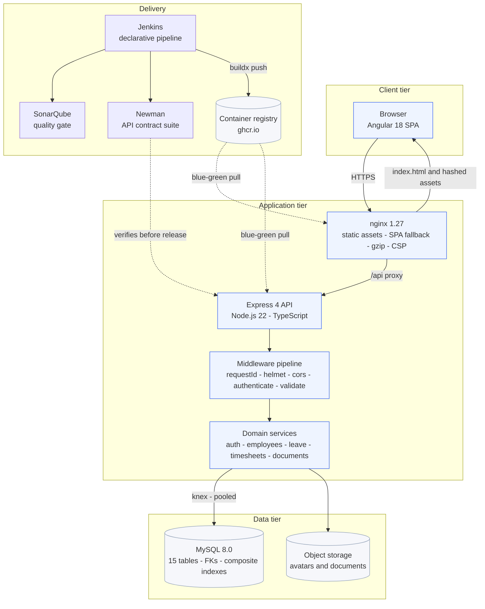
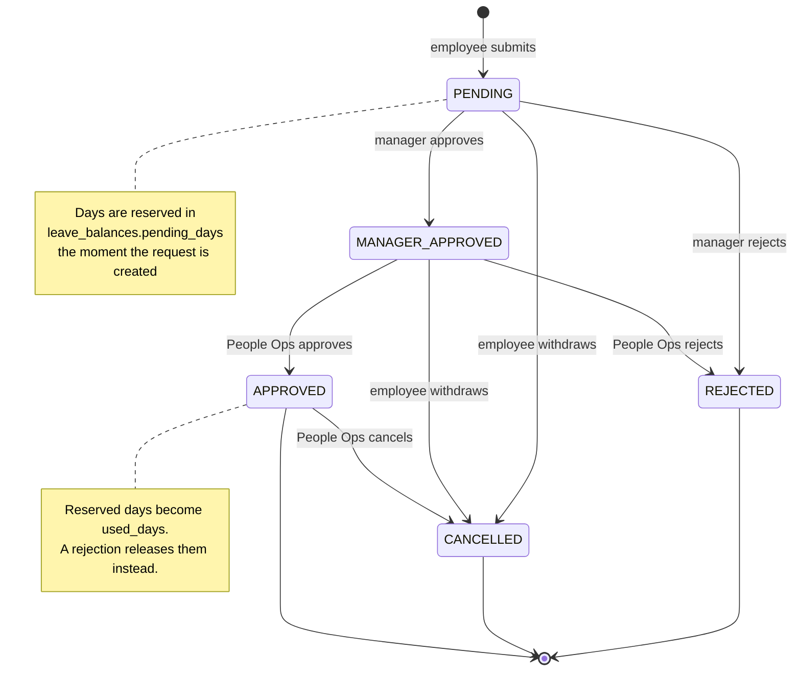
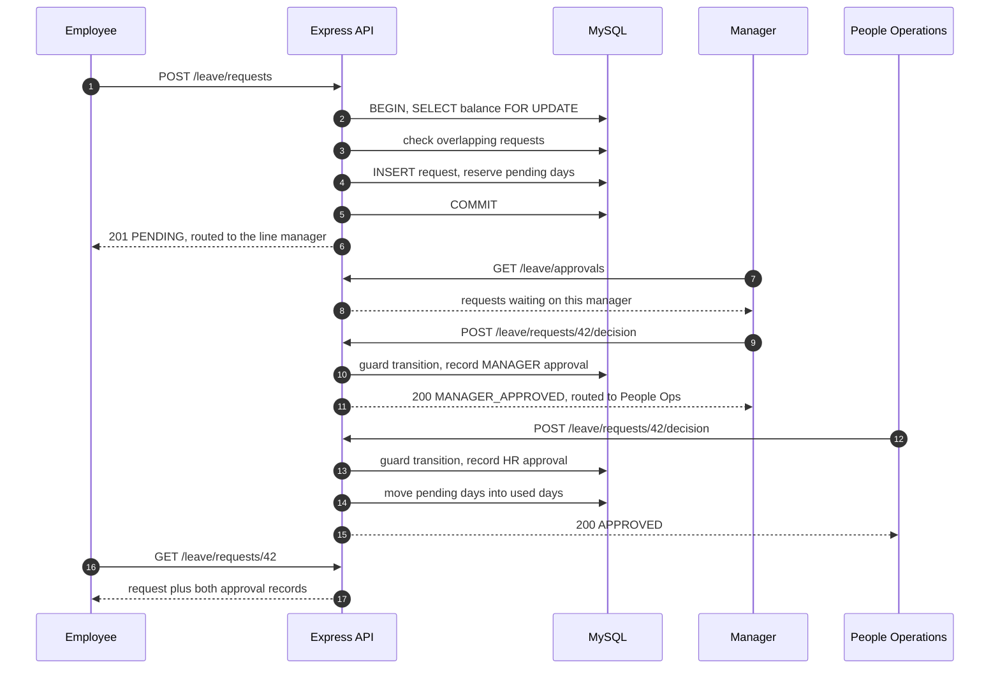

<div align="center">

# Enterprise Employee Portal

**HR self-service for the whole company, leave, timesheets, documents and the org chart, with a two-stage approval workflow and a CI/CD pipeline that will not let a broken contract reach production.**

[](https://angular.dev)
[](https://nodejs.org)
[](https://www.mysql.com)
[](https://www.jenkins.io)
[](LICENSE)

</div>



---

## Overview

Every company past about fifty people ends up running HR on email and
spreadsheets. An employee asks their manager for time off in a thread, the
manager forwards it to HR, someone updates a shared sheet, and three weeks
later nobody can say how many days that person has left or who actually
approved the absence. Timesheets arrive as attachments. Contracts live in
inboxes. The org chart is a slide that was last accurate two reorgs ago. None
of this is hard, but all of it is manual, and every manual step is a place
where the record and reality drift apart.

The Enterprise Employee Portal replaces that with a single system of record.
Employees see their own balances, request leave against them, fill in a weekly
timesheet and download their documents. Managers get an approval queue scoped
to their actual direct reports. People Operations gets the second approval
stage, company-wide visibility and an audit trail behind every decision. The
rules that matter, you cannot book leave you do not have, you cannot book two
absences over the same dates, you cannot approve your own request, a manager
cannot act outside their reporting line, are enforced in the API inside a
database transaction, not in the browser. The result is a portal where the
answer to "how many days do I have left?" is a number the system can defend,
and where "who approved this?" is a row, not a memory.

---

## Feature modules

| Module | What it does | Roles with access |
| --- | --- | --- |
| **Authentication** | JWT sessions with 15-minute access tokens and rotating 7-day refresh tokens, reuse detection, bcrypt password storage, per-account rate limiting | Everyone |
| **Dashboard** | Role-aware KPI tiles, leave balances, upcoming absences, headcount by team - one composed request | Everyone |
| **Profile** | Own contact details, avatar upload, password change that revokes other sessions | Everyone |
| **Directory** | Paginated, searchable, sortable employee directory with team filters | Everyone |
| **Leave** | Balances by type, request submission with overlap and balance validation, two-stage approval, calendar, cancellation | Employee submits · Manager approves stage 1 · HR approves stage 2 |
| **Timesheets** | Weekly project × day grid, draft/submit/approve lifecycle, utilisation totals | Employee submits · Manager approves |
| **Documents** | Upload, list and download with per-record visibility: private, manager, HR or company-wide | Owner · Manager (scoped) · HR |
| **Announcements** | Company feed with audience targeting and read receipts | Everyone reads · HR publishes |
| **Org chart** | Reporting hierarchy resolved by a MySQL recursive CTE, focusable at any node | Everyone |
| **Employee admin** | Create records, provision logins, reassign managers and departments | HR_ADMIN · SUPER_ADMIN |
| **Audit log** | Append-only record of every privileged mutation, correlated with the request logs | HR_ADMIN · SUPER_ADMIN |

Four roles, in increasing order of privilege: `EMPLOYEE`, `MANAGER`,
`HR_ADMIN`, `SUPER_ADMIN`. Route-level checks decide *which endpoints* a role
may call; service-level checks decide *which rows* it may touch.

---

## System architecture





---

## Application architecture

```mermaid
flowchart LR
    subgraph angular["Angular 18 - standalone and signals"]
        direction TB
        R["app.routes.ts<br/>lazy loadComponent"]
        G["Functional guards<br/>authGuard - roleGuard"]
        F["Feature components<br/>OnPush - signals"]
        FS["Feature services<br/>leave.service.ts"]
        CS["Core services<br/>AuthService - TokenService - ApiService"]
        I["Functional interceptors<br/>auth then error"]
        H["HttpClient"]
        R --> G --> F --> FS --> CS --> I --> H
    end

    subgraph express["Express 4 - layered"]
        direction TB
        RT["routes/index.ts"]
        MW["Middleware<br/>authenticate - authorize - validate"]
        C["Controller<br/>HTTP in and out only"]
        S["Service<br/>business rules - row authorisation - transactions"]
        RP["Repository<br/>query building"]
        K["Knex query builder"]
        DB[("MySQL 8")]
        RT --> MW --> C --> S --> RP --> K --> DB
    end

    H -->|"JSON over HTTPS"| RT

    classDef ng fill:#fff1f2,stroke:#dd0031
    classDef ex fill:#eef4ff,stroke:#3560f0
    class R,G,F,FS,CS,I,H ng
    class RT,MW,C,S,RP,K,DB ex
```



**The two rules that keep it honest.** A controller never contains a business
rule, if it holds an `if` that is not about HTTP, it belongs in the service,
which is what makes the services testable without Supertest. A repository never
makes an authorisation decision, it answers "give me the rows matching these
filters", and whether the caller may see them is a service question, because
only the service knows the actor.

---

## Data model

```mermaid
erDiagram
    USERS ||--o| EMPLOYEES : "authenticates as"
    USERS ||--o{ REFRESH_TOKENS : "owns sessions"
    USERS ||--o{ AUDIT_LOGS : "performs"

    DEPARTMENTS ||--o{ EMPLOYEES : "employs"
    EMPLOYEES ||--o{ EMPLOYEES : "manages"

    LEAVE_TYPES ||--o{ LEAVE_BALANCES : "allocates"
    LEAVE_TYPES ||--o{ LEAVE_REQUESTS : "classifies"
    EMPLOYEES ||--o{ LEAVE_BALANCES : "holds"
    EMPLOYEES ||--o{ LEAVE_REQUESTS : "submits"
    LEAVE_REQUESTS ||--o{ LEAVE_APPROVALS : "is decided by"
    EMPLOYEES ||--o{ LEAVE_APPROVALS : "decides"

    EMPLOYEES ||--o{ TIMESHEETS : "files"
    TIMESHEETS ||--o{ TIMESHEET_ENTRIES : "contains"
    PROJECTS ||--o{ TIMESHEET_ENTRIES : "is charged by"
    DEPARTMENTS ||--o{ PROJECTS : "owns"

    EMPLOYEES ||--o{ DOCUMENTS : "is subject of"
    EMPLOYEES ||--o{ ANNOUNCEMENTS : "authors"
    ANNOUNCEMENTS ||--o{ ANNOUNCEMENT_READS : "is acknowledged by"
    EMPLOYEES ||--o{ ANNOUNCEMENT_READS : "acknowledges"

    USERS {
        int id PK
        string email UK
        string password_hash
        enum role "EMPLOYEE MANAGER HR_ADMIN SUPER_ADMIN"
        bool is_active
        timestamp last_login_at
    }

    REFRESH_TOKENS {
        int id PK
        int user_id FK
        uuid jti UK
        string token_hash "sha256 - raw token never stored"
        uuid replaced_by_jti "rotation chain"
        timestamp expires_at
        timestamp revoked_at
    }

    DEPARTMENTS {
        int id PK
        string code UK
        string name
        int head_employee_id FK
        decimal annual_budget
        bool is_active
    }

    EMPLOYEES {
        int id PK
        int user_id FK "unique - nullable"
        string employee_code UK
        string first_name
        string last_name
        string job_title
        int department_id FK
        int manager_id FK "self reference"
        date hire_date
        enum employment_type
        enum status "ACTIVE ON_LEAVE TERMINATED"
    }

    LEAVE_TYPES {
        int id PK
        string code UK
        string name
        decimal default_annual_days
        bool is_paid
        bool carry_forward_allowed
    }

    LEAVE_BALANCES {
        int id PK
        int employee_id FK
        int leave_type_id FK
        smallint year
        decimal entitled_days
        decimal used_days
        decimal pending_days "reserved by in-flight requests"
        decimal carried_over_days
    }

    LEAVE_REQUESTS {
        int id PK
        int employee_id FK
        int leave_type_id FK
        date start_date
        date end_date
        decimal total_days "working days - half day counts 0.5"
        bool half_day
        string reason
        enum status "PENDING MANAGER_APPROVED APPROVED REJECTED CANCELLED"
        int current_approver_id FK
        timestamp decided_at
    }

    LEAVE_APPROVALS {
        int id PK
        int leave_request_id FK
        int approver_id FK
        enum stage "MANAGER HR"
        enum decision "APPROVED REJECTED"
        string comments
        timestamp decided_at
    }

    PROJECTS {
        int id PK
        string code UK
        string name
        string client_name
        int department_id FK
        bool is_billable
        bool is_active
    }

    TIMESHEETS {
        int id PK
        int employee_id FK
        date week_start_date "always a Monday"
        enum status "DRAFT SUBMITTED APPROVED REJECTED"
        decimal total_hours
        int approver_id FK
        timestamp submitted_at
    }

    TIMESHEET_ENTRIES {
        int id PK
        int timesheet_id FK
        int project_id FK
        date work_date
        decimal hours "CHECK between 0 and 24"
        string notes
    }

    DOCUMENTS {
        int id PK
        int employee_id FK
        int uploaded_by_id FK
        string title
        string category
        string storage_key UK
        int size_bytes
        enum visibility "PRIVATE MANAGER HR COMPANY"
        date expires_on
    }

    ANNOUNCEMENTS {
        int id PK
        int author_id FK
        string title
        text body
        enum audience "ALL DEPARTMENT MANAGERS"
        int department_id FK
        bool is_pinned
        timestamp published_at
    }

    ANNOUNCEMENT_READS {
        int id PK
        int announcement_id FK
        int employee_id FK
        timestamp read_at
    }

    AUDIT_LOGS {
        bigint id PK
        int actor_user_id FK
        string action
        string entity_type
        bigint entity_id
        json metadata
        string request_id "correlates with the structured logs"
        timestamp created_at
    }
```



Fifteen tables, real foreign keys, and unique indexes that encode workflow
invariants rather than just preventing typos, `(leave_request_id, stage)` on
`leave_approvals` means the database itself refuses a second decision at the
same stage, and `(employee_id, week_start_date)` on `timesheets` turns the
weekly grid save into an idempotent upsert instead of a read-then-write race.

---

## Leave approval workflow

The workflow is a state machine declared as data in
[`leave.state.ts`](api/src/modules/leave/leave.state.ts), with a transition
guard every mutation must pass. Adding a stage is a change to that map plus a
new action, not an audit of every call site.



An employee whose record has no manager, an executive, is routed straight to
the HR stage, so the workflow never stalls waiting for an approver who does not
exist.



---

## CI/CD pipeline

This is the part of the project worth reading closely. The pipeline is not a
"run the tests" script, it is a set of gates, each of which can stop a change
before it reaches somewhere it would do damage.

```mermaid
flowchart LR
    A["Checkout<br/>tag build with the commit SHA"] --> B["Install<br/>npm ci - api and web in parallel"]
    B --> C["Lint<br/>ESLint plus tsc --noEmit"]
    C --> D["Unit tests<br/>Jest - JUnit and Cobertura"]
    D --> E["SonarQube<br/>static analysis"]
    E --> F{"Quality gate"}
    F -->|fail| X["Pipeline aborted<br/>no image is ever built"]
    F -->|pass| G["Build<br/>tsc and ng build with bundle budgets"]
    G --> H["Newman<br/>39 requests against an ephemeral stack"]
    H -->|assertion fails| X
    H --> I["Docker buildx<br/>push SHA tag and latest"]
    I --> J["Deploy staging<br/>blue-green over SSH"]
    J --> K["Smoke tests<br/>health - version - auth - RBAC - latency"]
    K -->|fail| X
    K --> L{{"Manual approval<br/>release managers only"}}
    L -->|approved| M["Deploy production<br/>blue-green switchover"]
    L -->|timeout| Y["Aborted after 60 minutes"]
    M --> N["Production smoke tests"]
    N -->|fail| O["Automatic rollback<br/>flip back to the previous colour"]
    N -->|pass| P["Slack notification<br/>archive artefacts"]

    classDef gate fill:#fff7ed,stroke:#b45309,stroke-width:2px
    classDef bad fill:#fef2f2,stroke:#b91c1c
    classDef good fill:#ecfdf5,stroke:#047857
    class F,L gate
    class X,Y,O bad
    class P good
```



### Stages

| Stage | Tool | What it does | On failure |
| --- | --- | --- | --- |
| Checkout | git | Captures the commit SHA as `IMAGE_TAG`, renames the build | Fails fast |
| Install | npm | `npm ci` for both workspaces in parallel - the lockfile is authoritative | Fails, `failFast: true` |
| Lint | ESLint, tsc | Both workspaces plus a typecheck, `--max-warnings 0` | Fails after all linters report |
| Unit tests | Jest | API and web in parallel; publishes JUnit and Cobertura | Fails on a failing test; **unstable** below 55% line coverage |
| SonarQube | sonar-scanner | Static analysis fed the lcov reports from the previous stage | Fails |
| Quality gate | `waitForQualityGate` | Blocks on the Sonar webhook | **Aborts the pipeline** before any image exists |
| Build | tsc, Angular CLI | Production build with the `angular.json` bundle budgets | Fails, including on an oversized bundle |
| API validation | Postman + Newman | Ephemeral compose stack, migrate, seed, run the collection | Fails on the first failed assertion |
| Docker | buildx | Multi-stage build, registry layer cache, `:SHA` and `:latest` in one push | Fails |
| Deploy staging | SSH + compose | Blue/green: pull, migrate, start idle colour, health gate, switch | Fails; the previous colour keeps serving |
| Smoke tests | curl + jq | Health, **deployed version matches the tag**, auth, RBAC, latency | Blocks the production gate |
| Approval | `input` | Manual gate, `agent none`, restricted submitters, 60-minute timeout | Aborts on timeout |
| Deploy production | SSH + compose | Blue/green switchover with the approver's chosen strategy | **Automatic rollback** |
| Post | Slack, email | Colour-coded notification, archives reports, cleans the workspace | - |

### A representative slice of the Jenkinsfile

```groovy
stage('Postman API validation') {
  when { expression { return params.RUN_E2E } }
  agent { label 'linux && docker' }
  environment {
    COMPOSE_PROJECT_NAME = "portal-ci-${BUILD_NUMBER}"
    JWT_ACCESS_SECRET    = credentials('portal-ci-jwt-access-secret')
    JWT_REFRESH_SECRET   = credentials('portal-ci-jwt-refresh-secret')
  }
  steps {
    sh '''
      docker compose -f docker-compose.yml up -d --build mysql api

      for attempt in $(seq 1 40); do
        curl -fsS http://localhost:4000/api/v1/health/ready > /dev/null 2>&1 && break
        [ "${attempt}" = "40" ] && { docker compose logs --tail=200 api; exit 1; }
        sleep 3
      done

      docker compose --profile tools run --rm migrate

      docker run --rm --network host -v "$PWD:/etc/newman" -w /etc/newman \
        postman/newman:6-alpine \
          run postman/EmployeePortal.postman_collection.json \
          --environment postman/EmployeePortal.local.postman_environment.json \
          --reporters cli,junit,htmlextra \
          --reporter-htmlextra-export reports/newman/report.html \
          --bail failure
    '''
  }
  post {
    always {
      junit testResults: 'reports/newman/junit.xml', allowEmptyResults: true
      publishHTML target: [reportName: 'Newman API report',
                           reportDir: 'reports/newman', reportFiles: 'report.html',
                           keepAll: true, allowMissing: true]
      // Down *with volumes*: a leaked MySQL volume would make the next
      // build's seed non-deterministic.
      sh 'docker compose -f docker-compose.yml down --volumes --remove-orphans || true'
    }
  }
}
```

### The Newman validation gate

The Postman stage is what makes this pipeline more than a test runner. It spins
up a real MySQL, runs the real migrations, seeds the real demo dataset, and
drives the API through a complete employee → manager → HR workflow: 39 requests
and roughly 110 assertions, chained through environment variables so the
approval requests act on the leave request the earlier folder actually created.

It asserts behaviour, not just status codes, refresh-token rotation *and* the
rejection of a replayed token, overlap detection returning 409 naming the
conflicting request id, the state machine refusing an out-of-order decision,
balance arithmetic before and after the workflow, and org-chart tree integrity
(the returned `totalReports` must equal the actual node count). Three
assertions run against *every* request: response time under 1500ms, an echoed
`X-Request-Id`, and no `X-Powered-By` banner.

`--bail failure` stops on the first failure, because once the chain breaks
every later request fails for the same reason and the noise buries the cause.
The stage publishes an htmlextra report, a single page showing the exact
request, payload and assertion that failed, as **Newman API report** on the
build page.

**What the quality gate blocks.** `waitForQualityGate abortPipeline: true`
fails the build when, on new code: coverage is below 80%, duplicated lines
exceed 3%, any maintainability/reliability/security rating drops below A, or a
security hotspot is unreviewed. Both this gate and the Newman stage sit
*before* the Docker stage, so a regression never produces a pushed image, and
therefore can never be deployed by accident.

Full walkthrough, branch strategy and rollback procedure: **[docs/CI-CD.md](docs/CI-CD.md)**.

---

## Tech stack

| Layer | Technology | Why |
| --- | --- | --- |
| SPA | **Angular 18** (standalone, signals) | Standalone components removed the NgModule ceremony; signals give fine-grained reactivity without a store, and `@if`/`@for` are faster than the structural directives they replace |
| Language | **TypeScript 5.6** (strict both sides) | One language across the stack, and `strict` plus `strictTemplates` catches the class of bug that otherwise reaches the browser |
| Styling | **Tailwind CSS 3.4** | Utility classes keep styles next to the markup that owns them; no orphaned CSS file outlives its component |
| Runtime | **Node.js 22 LTS** | Native fetch, stable test runner, `AsyncLocalStorage` for request correlation, supported into 2027 |
| HTTP | **Express 4.21** | Small, predictable, and the middleware model maps cleanly onto the layering this project wanted |
| Validation | **Zod** | One schema validates *and* types the request, so there is no drift between the runtime check and the TypeScript type |
| Database | **MySQL 8.0** | Recursive CTEs for the org chart, CHECK constraints, window functions, and the transactional guarantees the leave workflow depends on |
| Query layer | **Knex** | Composable query building plus first-class migrations and seeds; SQL when it is needed, no ORM magic when it is not |
| Auth | **jsonwebtoken + bcryptjs** | Stateless access tokens for horizontal scaling, hashed refresh tokens in the database for revocation |
| Logging | **Winston** | JSON in production, with `AsyncLocalStorage` correlation ids threaded through every layer |
| API docs | **swagger-ui-express** | The spec is hand-written TypeScript, so it is reviewed in pull requests like any other code |
| API tests | **Postman + Newman** | The collection is a runnable contract; the same file is used by a developer in the GUI and by the pipeline headlessly |
| Unit tests | **Jest + Supertest + jest-preset-angular** | One runner for both workspaces; jsdom instead of Karma because the CI agents have no browser |
| Containers | **Docker multi-stage, nginx 1.27-alpine** | 180MB API runtime with no toolchain, 55MB web runtime with no Node.js, both non-root with healthchecks |
| CI/CD | **Jenkins** (declarative) | Parallel stages, a real manual approval gate, and pipeline-as-code that lives beside the application |
| Quality | **SonarQube + CodeQL** | A gate that blocks on new-code quality, plus weekly security scanning of unchanged code |

---

## Project structure

```
enterprise-employee-portal/
├── api/                             # Node.js 22 · Express 4 · TypeScript
│   ├── src/
│   │   ├── app.ts                   # Middleware pipeline (order is deliberate)
│   │   ├── server.ts                # Bootstrap + graceful shutdown on SIGTERM
│   │   ├── config/
│   │   │   ├── env.ts               # Zod-validated environment, fails fast at boot
│   │   │   └── knex.ts              # Pool, DATE handling, readiness ping
│   │   ├── db/
│   │   │   ├── migrations/          # 6 Knex migrations, index choices commented
│   │   │   └── seeds/               # Reference data + 12-person demo org
│   │   ├── middleware/              # authenticate · authorize · validate · errors · rateLimit · upload
│   │   ├── modules/                 # One folder per domain
│   │   │   ├── auth/                # login · refresh rotation · logout · me
│   │   │   ├── employees/           # directory · profiles · avatars · hierarchy
│   │   │   ├── departments/
│   │   │   ├── leave/               # ← leave.state.ts holds the workflow guard
│   │   │   ├── timesheets/
│   │   │   ├── documents/
│   │   │   ├── announcements/
│   │   │   ├── orgchart/            # ← recursive CTE lives here
│   │   │   └── dashboard/
│   │   ├── utils/                   # ApiError · asyncHandler · logger · paginate · jwt · audit
│   │   ├── docs/openapi.ts          # Served at /api-docs
│   │   └── __tests__/               # Supertest route tests (401 + RBAC 403)
│   └── Dockerfile                   # deps → build → runtime, non-root, dumb-init
│
├── web/                             # Angular 18 SPA
│   ├── src/app/
│   │   ├── app.config.ts            # provideRouter · withInterceptors · session initialiser
│   │   ├── app.routes.ts            # Every feature lazily loaded
│   │   ├── core/
│   │   │   ├── services/            # AuthService (signals) · TokenService · ApiService
│   │   │   ├── interceptors/        # Bearer + refresh-on-401 with a request queue
│   │   │   ├── guards/              # Functional CanActivateFn
│   │   │   └── models/              # Wire types mirroring the API DTOs
│   │   ├── shared/                  # 9 UI components · has-role directive · 2 pipes
│   │   ├── layout/                  # shell · sidebar (role-gated nav) · topbar
│   │   └── features/                # login · dashboard · profile · directory
│   │       ├── leave/               # my-requests · request-form · approvals · calendar
│   │       ├── timesheets/          # weekly grid editor
│   │       ├── org-chart/           # recursive tree renderer
│   │       └── admin/employees/
│   ├── nginx.conf                   # SPA fallback · gzip · CSP · /api proxy
│   └── Dockerfile                   # ng build → nginx:1.27-alpine
│
├── postman/                         # 39-request contract suite + environment
├── jenkins/                         # Setup guide · Job DSL seed · deploy + smoke scripts
├── docker/mysql/init/               # First-run database and user setup
├── docs/                            # ARCHITECTURE.md · CI-CD.md · SCREENSHOTS.md · openapi.yaml
├── .github/workflows/               # ci.yml (mirrors Jenkins) · codeql.yml
├── Jenkinsfile                      # The pipeline
└── docker-compose.yml               # mysql · api · web · adminer · migrate profile
```

---

## Getting started

### Prerequisites

| Tool | Version | Needed for |
| --- | --- | --- |
| Docker + Compose | 24+ / v2 | The quickest path - everything containerised |
| Node.js | 22 LTS | Running the API or SPA on the host |
| MySQL | 8.0 | Only if you skip Docker entirely |
| Newman | 6+ | Running the API contract suite locally |

### 1. Configure

```bash
git clone https://github.com/<your-username>/enterprise-employee-portal.git
cd enterprise-employee-portal
cp .env.example .env
```

Generate the two JWT secrets, compose refuses to start with the placeholders:

```bash
openssl rand -hex 48   # paste as JWT_ACCESS_SECRET
openssl rand -hex 48   # paste as JWT_REFRESH_SECRET
```

### 2. Run

```bash
docker compose up --build -d
```

### 3. Migrate and seed

```bash
docker compose --profile tools run --rm migrate
```

That applies all six migrations and loads the demo organisation: five
departments, twelve employees across a three-level hierarchy, four projects, a
full year of leave balances, and leave requests in every workflow state.

### 4. Open

| Service | URL | Notes |
| --- | --- | --- |
| **Web app** | <http://localhost:3000> | Angular SPA behind nginx |
| **API** | <http://localhost:4000/api/v1> | REST API |
| **Swagger UI** | <http://localhost:4000/api-docs> | Interactive, with "Try it out" |
| **Adminer** | <http://localhost:8080> | Server `mysql`, user `portal` |
| **Health** | <http://localhost:4000/health> | Liveness, includes the deployed version |

### Demo credentials

| Role | Email | Password | What you can do |
| --- | --- | --- | --- |
| Employee | `employee@portal.dev` | `Employee@12345` | Own leave, timesheets, documents, directory, org chart |
| Manager | `manager@portal.dev` | `Manager@12345` | The above, plus the approval queue for four direct reports |
| People Operations | `hr@portal.dev` | `HrAdmin@12345` | Company-wide: stage-two approvals, employee admin, announcements |
| Super admin | `admin@portal.dev` | `Admin@12345` | Everything, including department administration |

Nine more seeded employees share the password `Employee@12345` - see
[`02_demo_data.ts`](api/src/db/seeds/02_demo_data.ts) for the full roster.

### Running locally without Docker

Keep MySQL in a container and run both apps on the host so they hot reload:

```bash
docker compose up -d mysql adminer

# Terminal 1 — API on :4000
cd api
cp .env.example .env          # set DB_HOST=localhost and the two JWT secrets
npm install
npm run migrate
npm run seed
npm run dev                   # tsx watch

# Terminal 2 — SPA on :4200
cd web
npm install
npm start                     # ng serve with proxy.conf.json → :4000
```

The SPA is then at <http://localhost:4200>; `proxy.conf.json` forwards `/api`,
`/static` and `/api-docs` to the API, so there is no CORS to configure.

Useful scripts:

```bash
cd api
npm run db:reset        # roll back everything, migrate, reseed
npm run test            # Jest
npm run test:newman     # the Postman suite against localhost
npm run lint            # ESLint, zero warnings tolerated

cd web
npm test                # Jest via @angular-builders/jest
npm run build:prod      # enforces the bundle budgets
```

---

## API reference

Base URL `http://localhost:4000/api/v1`. Every endpoint except login, refresh
and the health probes requires `Authorization: Bearer <accessToken>`.

| Method | Path | Role | Description |
| --- | --- | --- | --- |
| `POST` | `/auth/login` | Public | Exchange credentials for a token pair |
| `POST` | `/auth/refresh` | Public | Rotate the refresh token; replay revokes the session family |
| `POST` | `/auth/logout` | Any | Revoke the supplied refresh token |
| `GET` | `/auth/me` | Any | Current session user |
| `POST` | `/auth/change-password` | Any | Change password; signs out other devices |
| `GET` | `/employees` | Any | Directory search with pagination, filters and whitelisted sorting |
| `GET` | `/employees/me` | Any | Own profile |
| `PATCH` | `/employees/me` | Any | Update own contact details |
| `GET` | `/employees/me/team` | Manager+ | Direct reports |
| `GET` | `/employees/:id` | Any | One employee |
| `POST` | `/employees` | HR+ | Create a record, optionally with a login |
| `PATCH` | `/employees/:id` | Manager (reports only) / HR | Update; privileged fields are HR-only |
| `POST` | `/employees/:id/avatar` | Self / HR | Avatar upload, 5MB, image types only |
| `GET` | `/departments` | Any | Departments with headcount |
| `POST` | `/departments` | HR+ | Create a department |
| `GET` | `/leave/types` | Any | Active leave types |
| `GET` | `/leave/balances` | Any (own) / Manager (reports) / HR | Balances for a year |
| `GET` | `/leave/requests` | Any | Own requests, filterable and paginated |
| `POST` | `/leave/requests` | Any | Submit - validates overlap and balance in one transaction |
| `GET` | `/leave/requests/:id` | Owner / line / HR | Request plus its approval trail |
| `POST` | `/leave/requests/:id/decision` | Manager / HR | Approve or reject at the current stage |
| `POST` | `/leave/requests/:id/cancel` | Owner / HR | Withdraw or cancel |
| `GET` | `/leave/approvals` | Manager+ | The approval inbox |
| `GET` | `/leave/calendar` | Any | Absences in a range, scoped ME / TEAM / COMPANY |
| `GET` | `/timesheets/week` | Self / Manager | Weekly grid, addressed by its Monday |
| `PUT` | `/timesheets/week` | Any | Save the whole week as a draft |
| `POST` | `/timesheets/week/submit` | Any | Submit for approval |
| `GET` | `/timesheets/pending` | Manager+ | Timesheets awaiting a decision |
| `POST` | `/timesheets/:id/decision` | Manager+ | Approve or reject |
| `GET` | `/documents` | Any | Documents the caller may see |
| `POST` | `/documents` | Any | Upload; company-wide visibility is HR-only |
| `GET` | `/documents/:id/download` | Per visibility | Stream a document |
| `GET` | `/announcements` | Any | Feed with per-viewer read state |
| `POST` | `/announcements` | HR+ | Publish |
| `POST` | `/announcements/:id/read` | Any | Record a read receipt |
| `GET` | `/org-chart` | Any | Reporting tree via a recursive CTE |
| `GET` | `/dashboard/summary` | Any | Role-aware KPI payload |
| `GET` | `/health/ready` | Public | Readiness, including a database round trip |

### Examples

**1 · Sign in**

```bash
curl -s -X POST http://localhost:4000/api/v1/auth/login \
  -H 'Content-Type: application/json' \
  -d '{"email":"employee@portal.dev","password":"Employee@12345"}'
```

```json
{
  "user": {
    "userId": 4,
    "employeeId": 4,
    "email": "employee@portal.dev",
    "role": "EMPLOYEE",
    "fullName": "Priya Raman",
    "jobTitle": "Senior Software Engineer",
    "departmentName": "Engineering",
    "managerId": 3,
    "mustChangePassword": false
  },
  "accessToken": "eyJhbGciOiJIUzI1NiIsInR5cCI6IkpXVCJ9.eyJyb2xlIjoiRU1QTE9ZRUUi...",
  "refreshToken": "eyJhbGciOiJIUzI1NiIsInR5cCI6IkpXVCJ9.eyJqdGkiOiI3YjFmMmM...",
  "expiresIn": "15m"
}
```

**2 · Submit a leave request**

```bash
curl -s -X POST http://localhost:4000/api/v1/leave/requests \
  -H "Authorization: Bearer $ACCESS_TOKEN" \
  -H 'Content-Type: application/json' \
  -d '{
        "leaveTypeId": 1,
        "startDate": "2026-10-12",
        "endDate": "2026-10-16",
        "reason": "Family wedding in Chennai.",
        "halfDay": false
      }'
```

```json
{
  "request": {
    "id": 42,
    "employeeId": 4,
    "employeeName": "Priya Raman",
    "leaveTypeCode": "ANNUAL",
    "startDate": "2026-10-12",
    "endDate": "2026-10-16",
    "totalDays": 5,
    "halfDay": false,
    "reason": "Family wedding in Chennai.",
    "status": "PENDING",
    "currentApproverId": 3,
    "currentApproverName": "Marcus Lee",
    "submittedAt": "2026-09-17T14:22:08.411Z",
    "decidedAt": null
  }
}
```

An overlapping range returns `409` instead:

```json
{
  "error": {
    "code": "CONFLICT",
    "message": "This range overlaps an existing APPROVED request (2026-10-14 to 2026-10-15)",
    "details": [{ "field": "startDate", "message": "Conflicting request #37" }]
  },
  "requestId": "8f1c9a2e-6f4b-4a1e-9f0d-7c2b5d3a1e44"
}
```

**3 · Approve it as the manager**

```bash
curl -s -X POST http://localhost:4000/api/v1/leave/requests/42/decision \
  -H "Authorization: Bearer $MANAGER_TOKEN" \
  -H 'Content-Type: application/json' \
  -d '{"decision":"APPROVED","comments":"Coverage confirmed with the team."}'
```

```json
{
  "request": {
    "id": 42,
    "status": "MANAGER_APPROVED",
    "currentApproverId": 2,
    "currentApproverName": "Sofia Marino",
    "totalDays": 5,
    "decidedAt": null
  }
}
```

The request now sits at the HR stage. A second call with the same manager token
returns `403` - `MANAGER` is not entitled to the `HR_APPROVE` action, and the
transition guard says so before anything is written.

---

## API validation with Postman & Newman

The [Postman collection](postman/EmployeePortal.postman_collection.json) is the
executable contract for the API: 39 requests in six ordered folders, roughly
110 assertions, chained through environment variables so a single run drives a
complete employee → manager → HR workflow rather than poking at endpoints in
isolation.

**What it asserts**

- **Auth** - token-pair shape, the response never containing a password hash,
  identical 401s for a wrong password and an unknown account, refresh
  *rotation* producing a different token, and a replayed refresh token being
  rejected with the session family revoked.
- **RBAC** - an employee getting 403 on employee creation, on a team listing
  and on the approvals inbox; a manager successfully listing reports that all
  carry their manager id.
- **Validation** - an unlisted sort column returning 400 with the field named,
  an inverted date range rejected, a calendar range over six months refused.
- **Leave workflow** - submission returning `PENDING` with a named approver and
  three chargeable working days; the overlap attempt returning 409 naming the
  conflicting request; rejection without a comment refused; the full
  `PENDING → MANAGER_APPROVED → APPROVED` walk; the approval trail carrying
  both stages; balance arithmetic verified before *and* after.
- **Org chart** - the returned `totalReports` matching a recursive count of the
  actual tree, and the whole query completing in under 800ms.
- **Every request** - response under 1500ms, an echoed `X-Request-Id`, no
  `X-Powered-By`.

**Running it**

```bash
newman run postman/EmployeePortal.postman_collection.json \
  --environment postman/EmployeePortal.local.postman_environment.json \
  --reporters cli,htmlextra,junit \
  --reporter-htmlextra-export reports/newman/report.html \
  --reporter-junit-export reports/newman/junit.xml \
  --bail failure
```

Or `cd api && npm run test:newman`, which wraps the same flags.

**In the pipeline.** The *Postman API validation* stage brings up an ephemeral
`mysql` + `api` compose stack, polls the readiness probe, runs migrations and
the seed, executes the collection inside `postman/newman:6-alpine`, publishes
the JUnit results and the HTML report, then tears the stack down *with its
volumes* so the next build's seed is deterministic. The stage sits before the
Docker stage, so a contract regression never produces a pushed image.

**The report.** `newman-reporter-htmlextra` produces one self-contained page
with a pass/fail summary, every request's full headers and body, the assertion
results and a response-time chart. Jenkins publishes it as **Newman API
report**; GitHub Actions uploads it as an artifact. When an API change breaks
the contract, that page usually contains enough to diagnose it without
reproducing anything locally.

More detail: [postman/README.md](postman/README.md).

---

## Testing

| Layer | Tool | Covers | Command |
| --- | --- | --- | --- |
| API unit | Jest + ts-jest | Auth service (login, rotation, reuse detection, password change), leave service (working-day arithmetic, balance gate, transition guards, overlap, decisions), pagination utilities | `cd api && npm test` |
| API integration | Supertest | The full middleware pipeline: 401 on a missing/forged token, RBAC 403s across four endpoints, validation 400s, the structured 404, the OpenAPI document | `cd api && npm test` |
| Web unit | Jest + jest-preset-angular | `AuthService` session signals, login/refresh/logout, session restore including the stale-token path; request-form validators and balance gating | `cd web && npm test` |
| API contract | Newman | 39 requests, ~110 assertions, full workflow chain | `npm run test:newman` |
| Smoke | curl + jq | Post-deploy: version match, readiness, auth, RBAC, latency budget | `jenkins/scripts/smoke-test.sh` |
| Security | CodeQL | Weekly SAST plus every push and PR | GitHub Actions |

Coverage thresholds are enforced in `api/jest.config.js` and reported to both
Jenkins (Cobertura, marking the build unstable below 55% lines) and SonarQube
(which gates on 80% of **new** code).

What each layer is for: unit tests pin down the logic that is genuinely
tricky, the working-day count, the balance arithmetic, the transition guard,
without a database. Supertest checks that the middleware stack actually returns
the status codes the contract claims. Newman checks that the whole system,
against a real MySQL with real seeded data, behaves the way the API promises.
The smoke tests check that what is running is what was built.

---

## Engineering notes

A few decisions worth explaining, because they are the ones a reviewer would
otherwise have to reverse-engineer.

**A recursive CTE for the org chart.** The naive version ("fetch my reports,
then each of theirs") is one round trip per node, fine for twelve people,
seconds of latency for four thousand. Fetching every employee and building the
tree in Node moves 95% of rows the viewer did not ask for and cannot be
depth-limited by the database. `WITH RECURSIVE` walks the adjacency list inside
MySQL using `idx_employees_manager`, returns exactly the requested subtree in
one round trip, and computes `depth` and a materialised `path` on the way down
, so `buildTree` assembles the nesting in a single pass. The `depth < ?` bound
is a real guard: bad data introducing a cycle would otherwise spin until MySQL
aborts the query.

**Composite indexes chosen from the query, not from the column list.** The rule
throughout is equality columns first, range columns last. `(employee_id,
status)` serves "my requests, filtered by status" *and* the status facet counts
from one index. `(employee_id, start_date, end_date)` serves overlap detection:
equality on the employee, then a range scan on the dates. `(current_approver_id,
status)` serves the approvals inbox. Every index in the migrations carries a
comment naming the query it exists for, so a future maintainer can tell whether
it is still earning its place.

**Offset pagination, deliberately, with a note on where it breaks.** The
directory and request lists let users jump to arbitrary pages and sort by
arbitrary columns, which a cursor cannot express. Page sizes are hard-capped at
100 so a crafted `?pageSize=100000` cannot turn one request into a table scan.
Offsets degrade at depth because MySQL still walks the skipped rows; the audit
log is where that will bite first, and it is also strictly
reverse-chronological, so it is the first candidate for keyset pagination
(`WHERE (created_at, id) < (?, ?)`) while the directory keeps offsets.

**Signals instead of NgRx.** The shared state in this app is one object, the
session. Everything else belongs to a single screen and dies with it, and the
server is the authority on anything that changes behind the user's back (a
balance moves when someone else approves a request). A normalised client store
would be a second, staler copy of the database. The derivations a store's
selectors would provide are `computed()` here, and HttpClient already models
the async. The cost is honest: no time-travel debugging and no global action
log, and a future WebSocket notification feed would need discipline. The
migration path is intact, because feature services already own all data access.

**Lazy routes and bundle budgets.** Every feature is a `loadComponent` or
`loadChildren`, so the initial bundle is the shell, core services and the login
screen. `PreloadAllModules` warms the rest once the app is idle, so users never
feel the split. `angular.json` sets an 800kB error threshold on the initial
bundle, which means a dependency that bloats the entry chunk fails the build
rather than quietly costing every user half a second.

**Refresh-token rotation with reuse detection.** Each refresh consumes exactly
one row and issues a new one, recording `replaced_by_jti`. Only the SHA-256
digest is stored, so a database dump cannot be replayed. A token that verifies
cryptographically but has no live row has already been used, the signature of
theft, so every session for that user is revoked and the event is logged at
`error`. On the client, a module-level flag and a `Subject` queue the parallel
requests that all 401 at once behind a single refresh, because five concurrent
refreshes would trip exactly this detection and kill a legitimate session.

**Two layers of authorisation, both required.** `authorize(...roles)` answers
"may this role call this endpoint?", cheap, declarative, visible in the route
file. Service-level checks answer "may this actor touch this row?", a manager
is limited to their reporting line, walked by a bounded recursive CTE.
Ownership failures return 403, not 404: the directory already tells every
employee the record exists. The SPA's `roleGuard` and `*appHasRole` are
convenience, never control.

**Rate limiting with two budgets.** A broad one keyed on user-or-IP for the
API, and a much tighter one on credential endpoints keyed on IP *and* the
submitted email, so one attacker cannot lock out a whole office NAT, while a
distributed attempt against a single account is still throttled. Login also
runs bcrypt against a dummy hash when the account does not exist, so response
timing cannot be used to enumerate accounts.

**Helmet with a real CSP.** The API serves JSON and Swagger UI, so its policy
is `default-src 'self'` with `'unsafe-inline'` styles only because swagger-ui
requires it. The SPA's policy lives in `web/nginx.conf`: no inline scripts at
all, fonts restricted to Google's two hosts, `frame-ancestors 'none'`. That
strict policy is also what makes storing tokens in `localStorage` defensible,
and the stronger design (httpOnly refresh cookie, access token in memory) is on
the roadmap.

**Graceful shutdown that actually runs.** On SIGTERM the server stops accepting
connections, lets in-flight requests finish, drains the MySQL pool and exits,
with a 15-second watchdog that forces the exit if a socket refuses to close.
This only works because `dumb-init` is PID 1 in the container, Node as PID 1
ignores default signal semantics and gets SIGKILLed after the grace period,
dropping whatever it was mid-way through.

**Structured logging with correlation ids.** `requestId` middleware seeds an
`AsyncLocalStorage` store, so every Winston line from controller to repository
carries the same id without threading a logger through every signature. That id
is echoed as `X-Request-Id`, returned in every error envelope, stored on the
`audit_logs` row, and shown in the UI's error toasts, so a user saying "it
failed, ref 8f1c9a2e" hands you the exact log stream.

---

## Deployment

- **Two images, one tag.** The API and web images are built once per commit and
  tagged with the 12-character commit SHA. The same image is promoted from
  staging to production, nothing is rebuilt between environments, only the
  environment variables differ.
- **Blue/green by default.** The target host runs `portal-blue` and
  `portal-green` behind an nginx upstream file; exactly one is live. A deploy
  starts the idle colour on its own ports, waits for *its* readiness probe,
  flips the upstream, reloads nginx, then drains the old colour after a
  60-second grace period. If the new colour never passes its health check, it
  is torn down and traffic never moved.
- **Migrations run once, before the switchover**, through a dedicated compose
  profile rather than inside the API container, several API replicas must not
  race to migrate. Schema changes are additive within a release, so the old
  colour keeps working against the migrated schema during the overlap.
- **Rollback is an upstream flip.** Because the previous colour is still
  running and healthy until the grace period ends, a rollback is
  `deploy.sh --rollback` and takes under 30 seconds. After the grace period it
  is a redeploy of the previous SHA. The production stage's `post { failure }`
  block triggers this automatically when the post-deploy smoke tests fail.
- **Database rollback is the case that is not free.** Every migration has a
  working `down()`, but a `down()` that drops a column destroys data, so the
  operational rule is additive-within-a-release (add, backfill, cut over,
  remove a release later), which means a code rollback never needs a schema
  rollback. A genuinely destructive migration ships alone, with a verified
  backup taken immediately before.
- **Verification is part of the deploy, not after it.** Smoke tests assert that
  `/health` reports the exact `IMAGE_TAG` that was built, the check that
  catches a deploy which silently kept serving the previous image.

---

## Limitations and roadmap

Known gaps in the current scope, and the planned follow-ups for each:

- **Refresh tokens are stored client-side.** Planned: move them to an `httpOnly`, `SameSite=Strict` cookie and keep the access token in memory only.
- **Rate limiting and org-chart caching are in-process**, so they are per-replica. Planned: Redis-backed implementations for multi-replica deployments.
- **Leave working-day counts ignore public holidays.** Planned: a per-location holiday calendar.
- **No notifications.** Planned: email and Slack on submission, approval and rejection, with per-user preferences.
- **Reporting.** Planned: leave liability by team as CSV and timesheet utilisation as XLSX.
- **Browser-level tests.** Planned: a Playwright suite covering the full approval journey.

---

## License

MIT, see [LICENSE](LICENSE).

---

## Maintainer

**Mariam Malik** - Software Engineer and Full-Stack Developer, with 1+ years
of professional experience. Currently maintaining this project.

Key skills: C++, Java (basics), JavaScript, React, Next.js and Node.js.

Contact: [mariammalik5100@gmail.com](mailto:mariammalik5100@gmail.com).