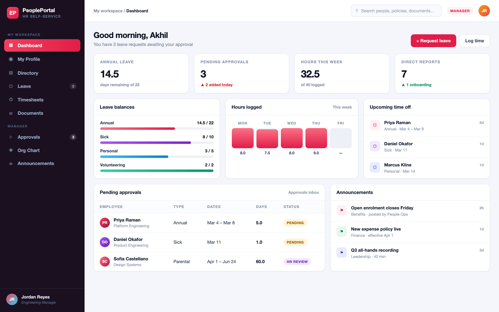
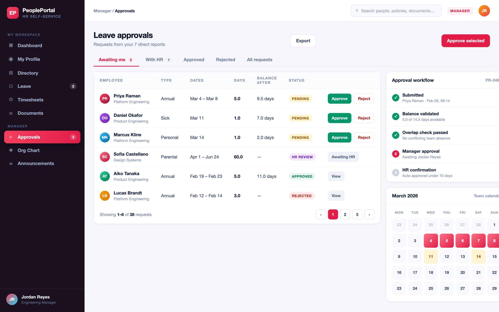

# Interface Preview

A short tour of the interface and the thinking behind each screen.

> **About the images.** The figures below are **design previews** of the UI —
> rendered mockups used for documentation, populated with representative data so
> the tables, badges and states are legible. They are not screen captures of a
> running build, and the volumes shown will not match the small seeded demo
> dataset exactly. The prose describes the behaviour actually implemented in
> `web/src/app`.

---

## Dashboard



The landing screen, signed in as **Priya Raman** (`employee@portal.dev`).

- **KPI tiles** are assembled server-side by `dashboard.service.ts` and vary by
  role: an employee sees their leave balance, hours logged this week and unread
  announcements; a manager additionally sees their approval queue and direct
  report count; People Operations sees company-wide figures.
- **Leave balances** show entitled, carried-over, used and pending days, with
  the progress bar reflecting consumption. Pending days are already subtracted
  from "available", so the figure never offers days that are effectively spent.
- **Upcoming absences** lists approved and manager-approved leave starting in
  the next fortnight, scoped to the viewer's team.
- **Headcount by team** is a single grouped query across active employees.

The whole screen is one request — `GET /api/v1/dashboard/summary` — rather than
six, which halves time-to-first-paint on the page users land on most.

---

## Leave request and approvals



The leave module, which is where most of the interesting logic lives.

**Request form** (left) uses a typed reactive form with four cross-field
validators: date ordering, half-day-must-be-one-day, no-working-days, and a
14-day back-dating window. The running summary underneath recomputes the
chargeable working-day count on every keystroke and shows the balance that
would remain after approval — turning red, and disabling submit, when the
request would exceed it. The same arithmetic is re-run server-side inside a
transaction with the balance row locked; the client copy exists to give
immediate feedback, not to be trusted.

**Approvals inbox** (right) shows what is genuinely waiting on the signed-in
user: a manager sees requests routed to them, People Operations sees everything
that has cleared its line manager. The decision dialog requires a comment on
rejection — enforced by the Zod schema on the API as well as in the UI — and
the status badge reflects the workflow state, from *Pending manager* through
*With People Ops* to *Approved*.

---

## Reproducing these screens

```bash
cp .env.example .env          # then generate the two JWT secrets
docker compose up -d --build
docker compose --profile tools run --rm migrate
open http://localhost:3000
```

| Screen | Sign in as | Route |
| --- | --- | --- |
| Dashboard | `employee@portal.dev` / `Employee@12345` | `/dashboard` |
| Request form | `employee@portal.dev` / `Employee@12345` | `/leave/new` |
| Approvals inbox | `manager@portal.dev` / `Manager@12345` | `/leave/approvals` |
| Org chart | any account | `/org-chart` |
| Manage employees | `hr@portal.dev` / `HrAdmin@12345` | `/admin/employees` |

The previews above are composed at 1440×900 in light mode. Sign in with the
accounts in the table to see the corresponding screens for real.
